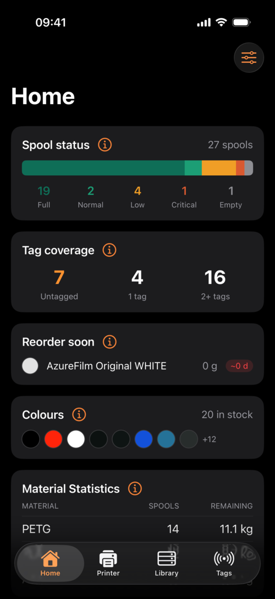
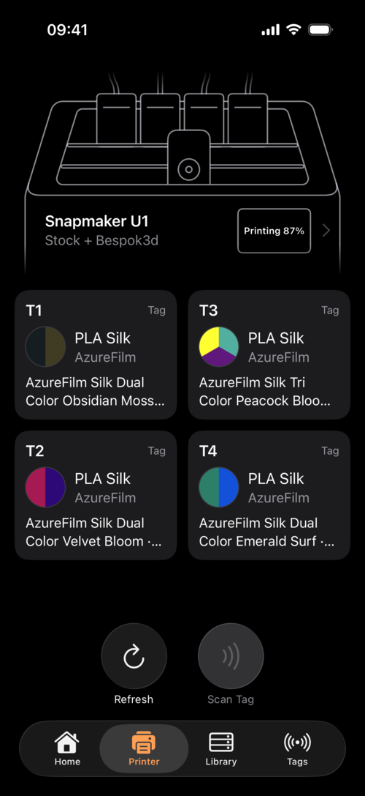
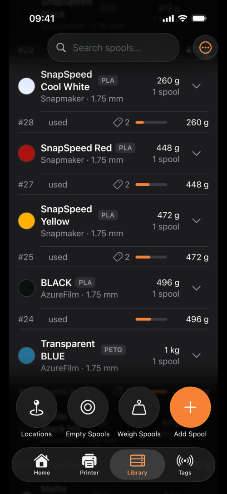
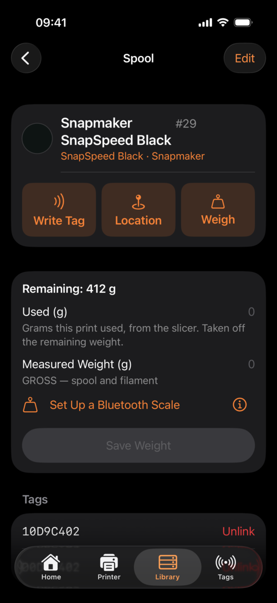
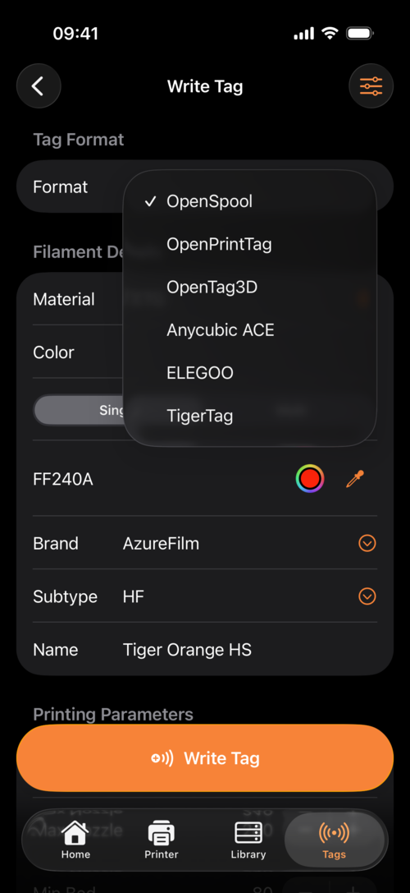
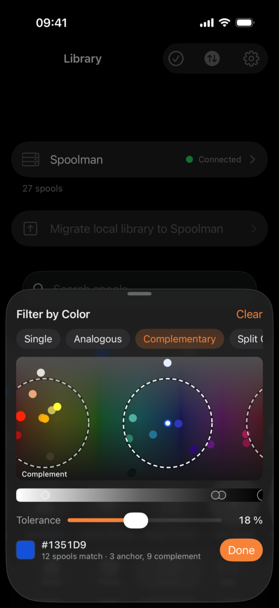

# SpoolKid

SpoolKid is an iOS app that keeps your filament spools, their NFC tags and your 3D printer in sync. Keep your library on the phone, or connect it to your self-hosted [Spoolman](https://github.com/Donkie/Spoolman) or [FilaMan](https://github.com/ManuelW77/Filaman) server. Read and write spool tags in six formats, scan labels with the camera, weigh spools on a Bluetooth scale, and see what each toolhead of your Snapmaker U1 holds.

I started SpoolKid to manage my own Snapmaker U1 filament with [paxx's Extended Firmware](https://github.com/paxx12/SnapmakerU1-Extended-Firmware) and its OpenSpool support. It now aims to work with as many tag formats, backends and printers as possible.

  
  
  

  
  
  

## Install

**TestFlight (recommended):** join the public beta at [testflight.apple.com/join/Y4BmejQk](https://testflight.apple.com/join/Y4BmejQk).

**Build from source** (Xcode 16+, iOS 18.0+, an Apple Developer account):

1. Clone the repository.
2. Copy `Development.xcconfig.template` to `Development.xcconfig` and set your Team ID.
3. Open `SpoolKid.xcodeproj` and run on a physical device (NFC and the camera don't work in the Simulator).

## Features

### Library and backends

- **Three interchangeable backends:** an on-device Library (no server needed), [Spoolman](https://github.com/Donkie/Spoolman), or [FilaMan](https://github.com/ManuelW77/Filaman). Move an on-device library to a server when you're ready.
- Spools, filaments, manufacturers and locations, grouped by filament, material, manufacturer, location or color family, with search.
- Read-first spool, filament and manufacturer pages; add spools from the [SpoolmanDB](https://github.com/Donkie/SpoolmanDB) or FilaManDB catalogue, several at once.
- Multi-color filaments, filament opacity and TD (transmission distance), with a TD1S reader.
- Empty-spool weights per brand, so a weighed spool knows how much filament is left.
- Spoolman sign-in with Basic Auth, API key or OpenID Connect.

### NFC tags

Reads and writes NTAG213/215/216 (and ISO 15693 for OpenPrintTag). Reading detects the format; writing uses the one you pick.

| Format | Notes |
|---|---|
| **OpenSpool** | JSON in NDEF. The default. |
| **OpenPrintTag** | Prusa's CBOR format on NFC-V tags, including remaining-filament updates. |
| **OpenTag3D** | NDEF with the `application/opentag3d` MIME type. |
| **Anycubic ACE** | Raw pages for the ACE Pro spool holder. |
| **ELEGOO** | Raw pages for ELEGOO RFID tags. |
| **TigerTag** | TigerTag's binary layout. |

- **One tag, one owner:** link any number of tags to a spool, a filament or a location. Links live in the spool's `card_uids` field (compatible with SpoolLink), in Spoolman's own tags on Spoolman 0.27+, and in FilaMan's `rfid_uid` when you turn that on.
- Scanning any tag, even an encrypted MIFARE Classic one, finds its spool by the tag's link, by the spool ID on the tag, or by matching the filament data against your library.
- Clone a tag byte for byte, inspect what's on a tag, and keep recently written tags for quick reuse.

### Snapmaker U1

- **Printer tab:** connects over Moonraker (stock firmware, Extended Firmware, Bespok3d) and shows what each of T1–T4 holds, live, and where each value came from.
- Put a spool into a toolhead by scanning its tag or picking it from the library; SpoolKid flags when the tag, the printer and your library disagree.
- **Read and write tags at the U1's own RFID readers**\* without holding the phone to the spool.
- Material and tag values are checked against what the U1 firmware understands.

\* Needs the [SpoolKid RFID Writer](https://github.com/marko-p/SpoolKid-RFID-Writer) plugin for Bespok3d.

### Camera and scale

- **Label scan:** reads QR codes and filament labels (OCR) and fills in the spool.
- **Bluetooth scale:** weigh spools one after another and save the remaining weight.
- **Color capture:** read a filament's color with the camera, optionally against a reference card.
- **Color Matching:** pick colors from a photo and find your closest spools; Filter by Color offers color harmonies.

### Settings

Settings that are part of a workflow live in the app (backend connection, which fields to show, the Home dashboard). Rarely touched utility and recovery switches live in the iOS Settings app (Settings › SpoolKid).

## Code structure

| Directory | Contents |
|---|---|
| `SpoolKid/Models/` | Tag payloads for each format, backend objects, scan results. |
| `SpoolKid/NFC/` | `NFCManager`: CoreNFC reading and writing. |
| `SpoolKid/Services/` | Backends (`SpoolDataRepository` and its Local, Spoolman and FilaMan conformers), tag formats, scan resolution, OCR, printer, scale. |
| `SpoolKid/Views/` | SwiftUI views. |
| `SpoolKid/Settings.bundle/` | The iOS Settings app page. |
| `SpoolKidTests/`, `SpoolKidUITests/` | Swift Testing unit tests and XCTest UI tests. |

SpoolKid uses no third-party libraries.

## License

SpoolKid is licensed under the [GNU AGPL v3.0](LICENSE) only. Commercial licenses are available from the author: see [COMMERCIAL.md](COMMERCIAL.md). Contributions need the CLA in [CONTRIBUTING.md](CONTRIBUTING.md).

Versions up to 0.9 were released under the MIT License. That source is still available at the [`v0.9`](https://github.com/marko-p/SpoolKid/tree/v0.9) tag.

## Support the project

SpoolKid is free, but keeping it running has recurring costs. If it saves you time, please consider helping cover them.

## Acknowledgments

- [Lucio](https://github.com/unlucio/) for testing, feedback, and pushing the Snapmaker U1 community toward Spoolman integration.
- [Donkie](https://github.com/Donkie) for Spoolman and SpoolmanDB.
- [ManuelW77](https://github.com/ManuelW77) for FilaMan and its filament database.
- [paxx12](https://github.com/paxx12) for the Snapmaker U1 Extended Firmware, which inspired this project.
